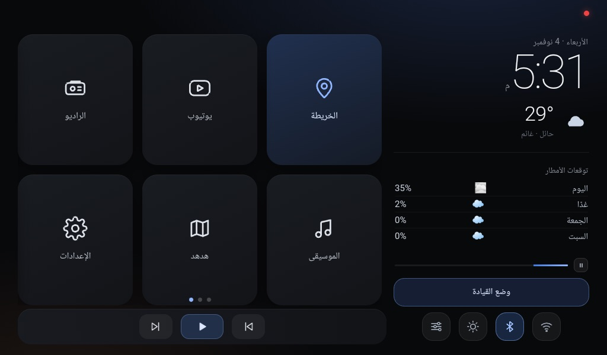
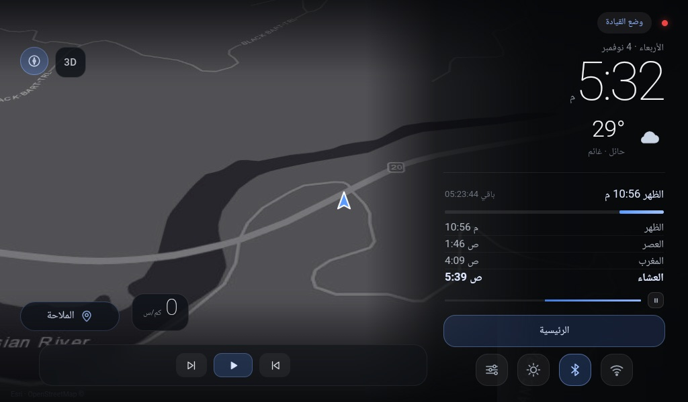
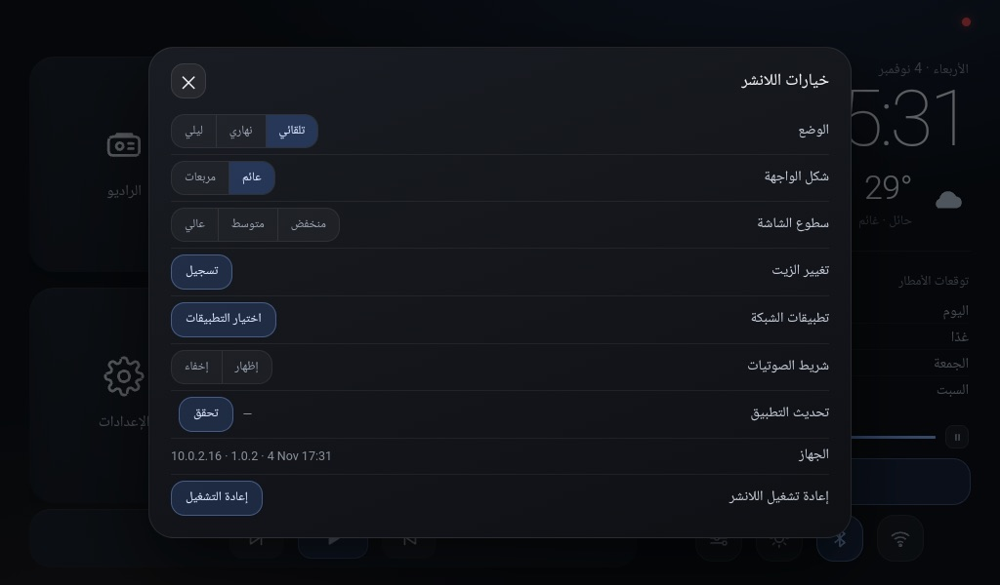

# واجهة السيارة · K2501

لانشر أندرويد خفيف لشاشة سيارة **1024×600** — واجهة عربية كاملة فيها الخريطة، مواقيت الصلاة، الطقس، والتطبيقات في شاشة واحدة، بدون أي مكتبة خارجية.


-3DDC84?style=flat-square)


<p align="center">
  
  
</p>

## المزايا

- **واجهتان تتبدّلان تلقائياً:** وضع وقوف (شبكة تطبيقات + بطاقة معلومات) ووضع قيادة (خريطة بكامل الشاشة).
- **خريطة** ببلاطات Esri، تبديل 3D/2D، بوصلة، عدّاد سرعة، ومسافة الرحلة — مع كاش محلي يشتغل بدون إنترنت.
- **مواقيت الصلاة** محسوبة محلياً (أم القرى) مع أذان وإقامة وخفض صوت الوسائط تلقائياً.
- **الطقس** لحائل: الحالة الحالية، توقعات المطر، والحرارة لخمسة أيام من Open-Meteo.
- **تحديث من داخل التطبيق:** فحص تلقائي عند الاتصال، تنزيل من GitHub Releases، وتثبيت صامت.
- **تحكم بالجهاز:** البلوتوث، الواي فاي، سطوع الشاشة، وصوت النظام — كلها من الواجهة.
- **عربي بالكامل** بتخطيط RTL وخطوط مقروءة من مسافة الذراع.

## التحديث

<p align="center">
  
</p>

من **الخيارات ← تحديث التطبيق**:

- يعرض النسخة الحالية وحالتها، وفيه زر «تحقق».
- يفحص تلقائياً أول ما يتصل الجهاز بالإنترنت (بحد أقصى مرة كل ٦ ساعات).
- ينزّل الـAPK من آخر إصدار، ويتحقق إنه نفس التطبيق، ثم يثبّته صامتاً عبر adbd المحلي.

## التركيب

نزّل الـAPK من [أحدث إصدار](../../releases/latest) ثم:

```bash
adb install -r app-debug.apk
```

أو مباشرة على الجهاز المتصل بالشبكة:

```bash
adb connect 192.168.100.37:5555
adb install -r app-debug.apk
```

## البناء من المصدر

المتطلبات: JDK 17، Android SDK 34.

```bash
export JAVA_HOME=/opt/homebrew/opt/openjdk@17
export ANDROID_HOME=$HOME/Library/Android/sdk
gradle assembleDebug
```

الناتج: `app/build/outputs/apk/debug/app-debug.apk`

## بنية المشروع

```
app/src/main/java/com/omar/carlauncher/
  MainActivity.java      # الواجهة، الخريطة، الطقس، الصوت، التحديث
  StateReceiver.java     # أوامر adb (تبديل الوضع للتجربة)
app/src/main/assets/
  ui.html                # كل الواجهة: HTML + CSS + JS
  adhan.ogg / iqama.ogg  # الأصوات
```

## ملاحظات

- الجهاز المستهدف: K2501، أندرويد 10، شاشة 1024×600، معمارية armeabi-v7a.
- إحداثيات المدينة الافتراضية في `ui.html` (`LAT`, `LON`) — غيّرها لمدينتك.
- التثبيت الصامت يحتاج صلاحية root على الجهاز (adbd). بدونه يظهر مسار الملف للتثبيت اليدوي.

## الترخيص

[MIT](LICENSE) © 2026 Omar Al-Tamimi
